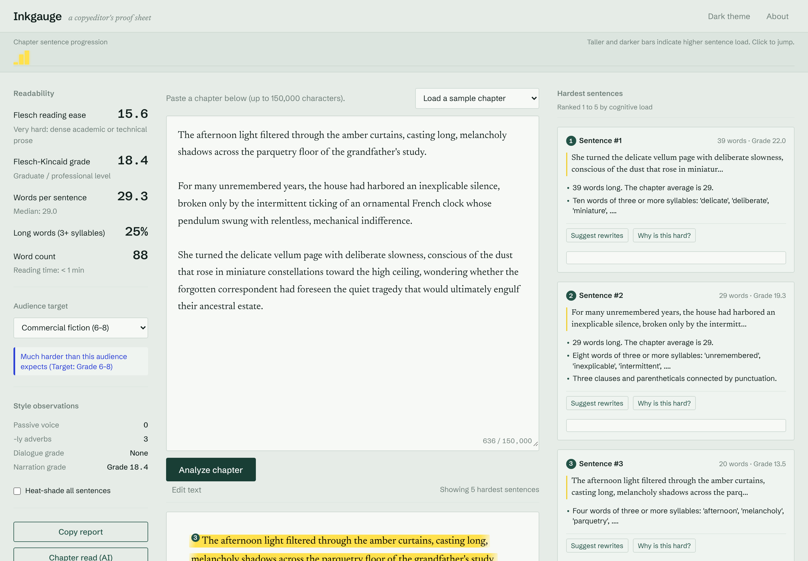
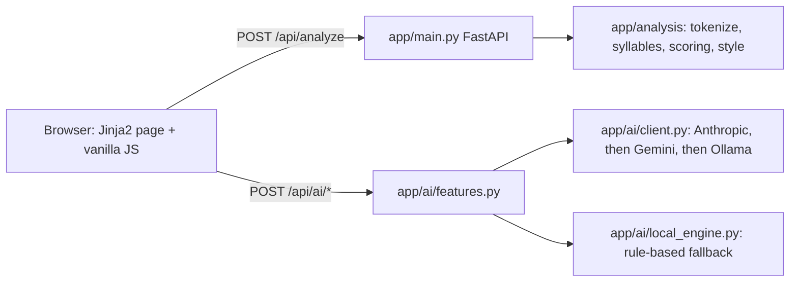

# Inkgauge - a web app that scores the readability of a pasted English chapter and marks its five hardest sentences

[Quick start](#quick-start) | [Limitations](#limitations-and-scope)

## At a glance
- **What:** A FastAPI app that scores up to 150,000 characters of prose with Flesch Reading Ease, Flesch-Kincaid grade and style counts. It highlights the five highest-load sentences with margin notes.
- **Why it matters:** Authors and editors see which sentences slow a reader down, and why, against a chosen audience target.
- **Status:** Side project, beta. 32 tests pass on 2026-11-07 at commit `4f5a911`. Not in scope: non-English text and verse. Author: Medwin Jose.



## Problem and approach
Readability scores for a whole chapter do not say where a reader stalls. Inkgauge splits the text into sentences with `pysbd` and counts syllables with CMUdict plus a rule-based fallback. It ranks each sentence of four or more words by a weighted load score: grade, length, long-word share, clause count and passive voice.

## Architecture

The analysis path is pure Python and needs no keys. The three assist endpoints (rewrite, explain, chapter read) try each configured provider in order and fall back to `local_engine.py`. That engine uses phrase substitution and sentence statistics, not a language model. Rewrite grades are recomputed by the app's own scoring code.

## Verification and assurance
- Tests: 32 passing on 2026-11-07 with Python 3.13.18 (`pytest -q`), covering syllables, tokenisation, scoring and the HTTP API.
- External providers are tested with mocked Anthropic and Gemini calls; Ollama has no test.
- No CI workflow and no linter configuration exist.

## Limitations and scope
- Readability formulas are calibrated for English; other languages get a notice and approximate scores.
- Rate limits (per IP: 30 analyses per minute, 30 assist calls per hour) live in process memory and reset per process.
- Assist responses are cached in process memory for 1 hour.
- Text is not written to disk, but when an external provider key is set, sentences are sent to that provider.

## Quick start
Requires Python 3.11 or newer and git.

```bash
git clone https://github.com/medwinjose/Inkgauge.git
cd Inkgauge
python -m venv .venv && source .venv/bin/activate
pip install -r requirements.txt pytest
pytest -q
uvicorn app.main:app --host 127.0.0.1 --port 8000
```

Open http://127.0.0.1:8000. To reproduce one result, run this in a second shell from the repository root; it prints `30.6 65 3` (grade, words, sentences):

```bash
python -c "import httpx; d = httpx.post('http://127.0.0.1:8000/api/analyze', json={'text': open('tests/fixtures/dense_business.txt').read(), 'audience': 'nonfiction_business'}).json(); print(d['grade_level'], d['word_count'], d['sentence_count'])"
```

Optional provider keys and model names go in `.env`; see [.env.example](.env.example).

## Author and contact
Medwin Jose - [github.com/medwinjose](https://github.com/medwinjose)

## License
No license file is included, so all rights are reserved by default.
